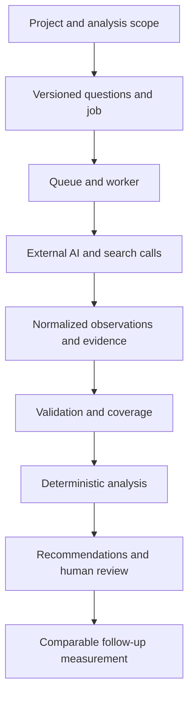

# Entity AI — architecture case study

Turning heterogeneous AI responses into traceable business analysis.

Entity AI measures how brands appear across AI and search surfaces and turns
the evidence into reviewable recommendations. The engineering problem is broader
than prompting: coordinate external services, preserve comparable inputs, separate
missing data from negative findings, and produce results a person can inspect.

This is a **sanitized architecture study**, not the product source or a deployable
copy. The architecture notes are grounded in a review of the private implementation.
The small Python example was written specifically for this repository; every
provider and observation in it is synthetic. No customer payloads, private prompts,
credentials, deployment addresses or commercial agreements are included.

## Process



| Concern | Architectural response | Trade-off |
| --- | --- | --- |
| Different provider formats | Normalize before aggregation; retain evidence and provider identity | Integration behavior still differs across providers |
| Partial or failed calls | Track coverage separately from findings | A partial report is less tidy but more honest |
| Long-running analysis | Separate request handling from queued worker execution | Job recovery and duplicate work need explicit handling |
| AI variability | Use models for interpretation; deterministic code for accounting and validation | Model outputs still require evaluation |
| Comparable follow-ups | Keep a versioned question set and measurement context | Changed samples must not silently become a trend |

## What this demonstrates

The relevant skills for an AI Process & Business Excellence role are process
decomposition, API integration, structured data contracts, exception handling,
observability and measurement. The same questions apply to an internal workflow:
what comes in, who owns the result, what can fail, what needs human review, and
how will we know the process improved?

This study is prepared with the 1KOMMA5 role in mind. It is an independent
portfolio example; it does not represent a system built for or endorsed by 1KOMMA5.
There are no claims of measured customer savings, accuracy or production SLAs.

## Read or run

- [Architecture and boundaries](docs/ARCHITECTURE.md)
- [Decisions and reliability](docs/RELIABILITY.md)
- [Process improvement and measurement](docs/PROCESS_CASE_STUDY.md)
- [Scope, evidence and limitations](docs/SCOPE.md)
- [Synthetic normalized result](examples/normalized-output.json)

Python 3.10+ is sufficient; the demo uses only the standard library and makes no
network requests:

```sh
python examples/workflow.py
python -m unittest discover -s tests -v
```

The example validates per-provider records, distinguishes failed calls from a
measured absence, rejects duplicate question IDs and exposes partial coverage.
Tests cover those failure cases. They validate this public example, not the
private platform.

## AI-assisted development

AI tools supported development and preparation of this study. The review standard
is explicit contracts, inspectable evidence and reproducible checks. The architecture
notes distinguish observed implementation mechanisms from recommendations and from
the deliberately smaller public demonstration.
