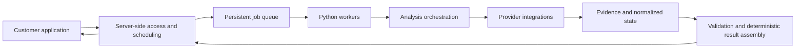

# Architecture and boundaries

## Product structure

The reviewed system separates a customer application, server-side request and
scheduling functions, a Python API, a persistent job queue and worker processes.
Workers execute an analysis graph, integrate external data providers, and assemble
results for the customer application. This is a high-level description; product
configuration, exact provider routing and deployment details remain private.

## Contracts between stages

The execution manager wraps stages with status and telemetry, computes patches
against a prior state, and merges permitted writes. Some result keys are protected
from ordinary stages; validator/finalizer paths have different authority. This
reduces accidental overwrites when multiple stages contribute to an analysis.
The mechanism is a contract to test, not a security sandbox for arbitrary code.

Some independent branches run concurrently. Input state is copied and resulting
patches are merged under explicit rules. This buys parallelism but introduces
copying overhead and makes write ownership part of the design.

Required analysis stages can fail the run; optional-stage failure can produce a
degraded result. A successful provider response is not by itself a valid business
finding: normalization, evidence checks and coverage still matter.

## Deterministic and probabilistic work

| Deterministic responsibility | Probabilistic responsibility |
| --- | --- |
| Job identifiers, state transitions and limits | Interpreting unstructured provider responses |
| Question-set identity and observation counts | Drafting explanations and recommendations |
| Coverage denominators and unavailable values | Language-dependent reasoning over supplied evidence |
| Schema checks and write ownership | Tasks whose quality needs representative evaluation |

A model must not decide whether a timeout counts as a negative observation or
silently replace a failed provider with a different measurement source.

## What the public example leaves out

`examples/workflow.py` only demonstrates a normalized observation boundary and
per-provider coverage accounting. It does not contain the real execution graph,
provider adapters, queue, persistence, model prompts, billing, authentication,
customer interfaces or recommendation logic. Its simplified JSON is a teaching
contract, not a leaked production schema.
